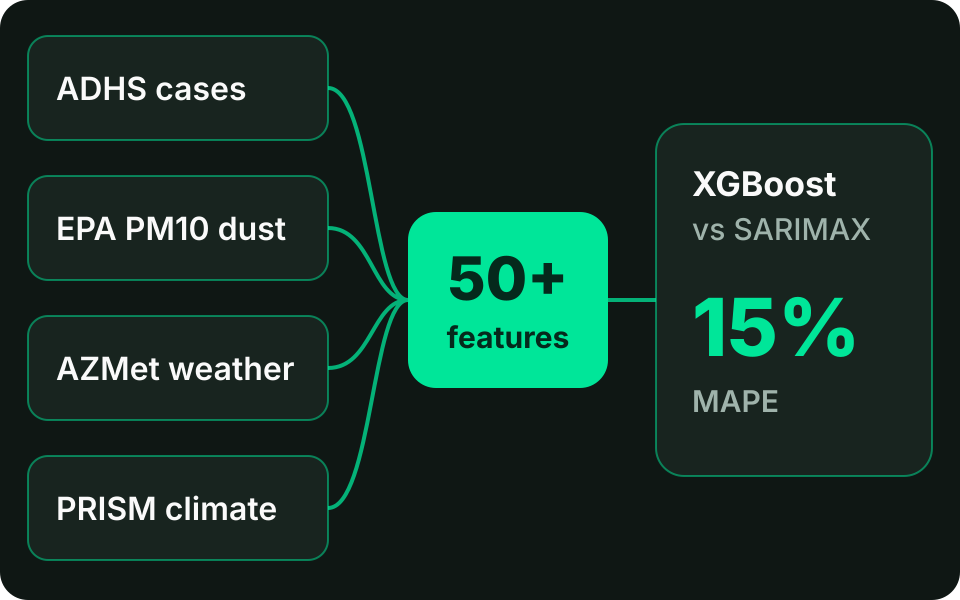
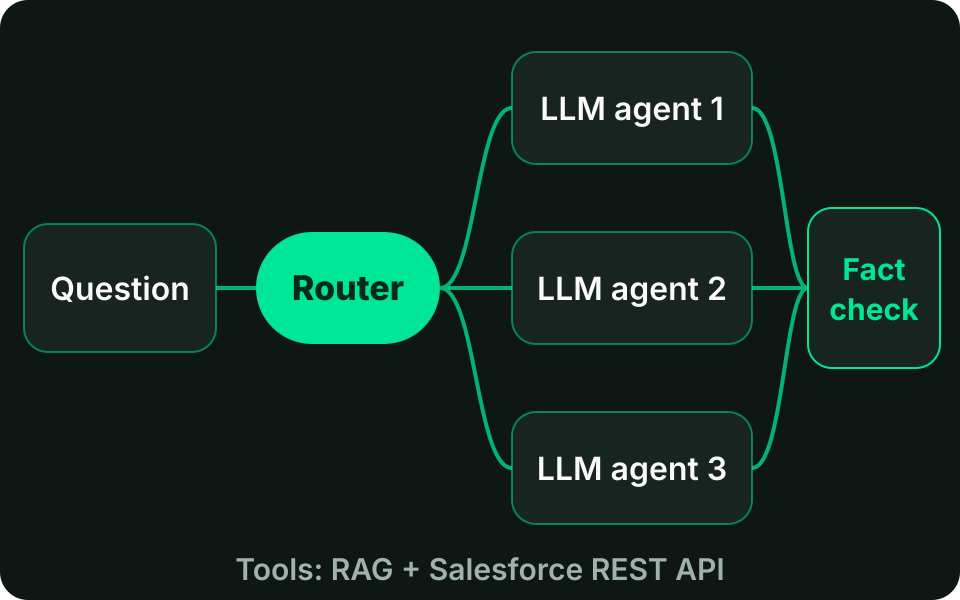

  

  

  
  
  
  
  

  <b>Open to full-time roles in the US:</b> Data Science · Data Analytics · Software Engineering · Sales/Solutions Engineering

---

## 🚀 About me

I'm completing an **M.S. in Data Science & Analytics at Arizona State University** (Dec 2026, **4.00 GPA**) after **4+ years** building data pipelines, automation and dashboards at **DXC Technology** and **Accenture**. At **Rubrik** I worked as a **Business Operations Analyst**, turning customer requirements into sales operations insights and coordinating proofs of concept. I like problems where a model or a dashboard has to convince a real stakeholder.

  

---

## ⭐ Featured projects

<table>
  <tr>
    <td width="50%" valign="top">
      
      <h3>🦠 <a href="https://github.com/1998-aish/Valley-fever-forecasting">Valley Fever Outbreak Forecasting</a></h3>
      ASU capstone forecasting county-level outbreak risk in Arizona from public health, air quality and weather data.  
      <b>Result:</b> <b>15% MAPE</b>, 25% better than a seasonal baseline; 4 sources (80K+ records) into 50+ features, explained with SHAP.  
      
      
      
    </td>
    <td width="50%" valign="top">
      
      <h3>🤖 SE Copilot: Multi-Agent LLM System</h3>
      A router sends each question to the right LLM agent, which draws on RAG and the Salesforce REST API, with hallucination checks on every answer.  
      <b>Result:</b> shipped <b>3 LLM agents</b>, adopted by <b>5+ engineers</b>.  
      
      
      
    </td>
  </tr>
  <tr>
    <td colspan="2">
      
      <h3>📉 <a href="https://github.com/1998-aish/churn-prediction-ml">Customer Churn Prediction</a></h3>
      Flags telecom customers likely to leave so retention teams can act early. Built as a tuned pipeline with a Streamlit app, a test suite and CI.  
      <b>Result:</b> <b>80.6% accuracy</b> on 7,043 customers; the recall-tuned model catches <b>79% of churners</b>, and the riskiest 20% of customers include half of all churners.  
      
      
      
      
      
    </td>
  </tr>
  <tr>
    <td width="50%" valign="top">
      
      <h3>🛍️ <a href="https://github.com/1998-aish/customer-segmentation-ml">Customer Segmentation</a></h3>
      <b>6 data-driven segments</b> chosen by silhouette analysis, each with a marketing action. Surfaced a 16% "affluent but low-spending" growth segment.  
      
      
    </td>
    <td width="50%" valign="top">
      
      <h3>🍕 <a href="https://github.com/1998-aish/pizza_sales_SQL">Pizza Sales Analysis</a></h3>
      <b>$818K revenue / 21K orders</b> analyzed in SQL to find lunch and dinner rush windows, the busiest days, and menu items to cut.  
      
      
    </td>
  </tr>
  <tr>
    <td width="50%" valign="top">
      
      <h3>🎬 <a href="https://github.com/1998-aish/Netflix-Analysis">Movie Catalog Analysis</a></h3>
      9.8K movies analyzed: <b>Animation is the high-popularity, high-rating "sweet spot"</b>, while Action and Sci-Fi draw clicks but rate low.  
      
      
    </td>
    <td width="50%" valign="top">
      
      <h3>🔎 <a href="https://github.com/1998-aish/Google-Data-Analysis-using-Python">Google Trends Analysis</a></h3>
      Global search demand via the PyTrends API: <b>"machine learning" is searched ~3–4× more than "cloud computing"</b>, and all three topics peak in June.  
      
      
    </td>
  </tr>
</table>

---

## 💼 Experience

  

**Rubrik | Business Operations Analyst** · Austin, TX · Jun 2026 – Aug 2026

- Analyzed customer requirements from **20+ calls across 8+ industries**, turning recurring operational challenges into structured insights for sales planning and solution evaluation
- Coordinated proof-of-concept activities across customer environments, tracking deployment progress, technical blockers and stakeholder feedback
- Built reporting summaries from customer discussions, validation results and issue logs, highlighting trends, process gaps and follow-ups
- Partnered with engineering and sales operations to document workflow requirements, clarify issue ownership and standardize handoffs

**Arizona State University | Business Operations Analyst (Part-time)** · Tempe, AZ · Mar 2026 – Present

- Created Excel dashboards tracking **25+ purchase orders and invoices per month** across **7+ departments**, reconciling records weekly and monthly

**Accenture | Business Operations Analyst** · Bengaluru, India · Apr 2023 – Dec 2024

- Found automation opportunities in process execution data with Python, improving workflow processing speed by **40%**
- Automated repetitive data processing with Python and REST API integrations, eliminating **20+ hours of manual work per week**
- Analyzed application monitoring, incident trends and SLA compliance, coordinating fixes that cut service-level violations by **18%**
- Documented automation workflows, exception handling and monitoring requirements to standardize operations

**DXC Technology | Business Operations Analyst** · Bengaluru, India · Jul 2020 – Mar 2023

- Consolidated operational data from multiple business systems with Python, SQL and ETL pipelines for consistent reporting
- Validated transformations and resolved recurring processing issues, improving pipeline stability by **35%**
- Traced recurring failures through SQL analysis and application logs, reducing pipeline failures by **24%**
- Integrated data across platforms with REST APIs and optimized SQL · **Quarterly Champ Award** · **promoted within 1.8 years** · Team Leader for the Belron account

**Education:** M.S. Data Science & Analytics, Arizona State University (Jan 2025 – Dec 2026, 4.00 GPA) · B.Tech. Computer Science, Dr. B.C. Roy Engineering College (2016 – 2020, 3.5 GPA)

**Certifications:** Microsoft Azure Fundamentals (AZ-900) · Certified ScrumMaster (CSM) · Automation Anywhere Advanced RPA Professional · Oracle OCI Foundations · CodePath Foundations of AI Engineering

---

## 🛠 Tech stack

  
   
  

  
  
  
  
  
  
  
  
  
  
  
  
  
  
  
  
  
  
  

<i>A/B testing · regression · classification · clustering · time-series forecasting · NLP · REST APIs · Agile/Scrum</i>

| Area | Skills |
|---|---|
| **Data Analytics & BI** | Python, SQL, R, pandas, EDA, statistical modeling, regression, logistic regression, hypothesis testing, A/B testing, KPI reporting, data visualization, trend analysis, performance dashboards, decision analytics, business reporting, operational forecasting |
| **Automation, Systems & AI** | ETL pipelines, REST APIs, Python scripting, SQL query optimization, data integration, data transformation, Docker, Kubernetes, Salesforce API, OpenAI API, LangGraph, RAG, multi-agent systems, AI workflow orchestration |
| **Business Operations & Process** | Operations analysis, business process improvement, workflow optimization, operational excellence, requirements gathering, stakeholder management, cross-functional coordination, sales operations, process standardization, root cause analysis, exception management, process documentation, continuous improvement, operational handoffs, strategic planning |
| **Service Delivery & Enterprise Ops** | SLA compliance, incident management, service performance monitoring, operational risk assessment, issue tracking, customer requirements analysis, PoC coordination, deployment tracking, data quality validation, pipeline reliability, production troubleshooting, system performance analysis, technical log analysis, service delivery management |
| **Machine Learning & Cloud** | scikit-learn, XGBoost, classification, clustering, time-series forecasting (SARIMAX), SHAP, NLP, TensorFlow, MLflow, AWS, Azure, GCP, CI/CD |

---

  <b>📫 Let's connect.</b> I'm happy to chat about data, automation, or roles on your team.  
  
  

